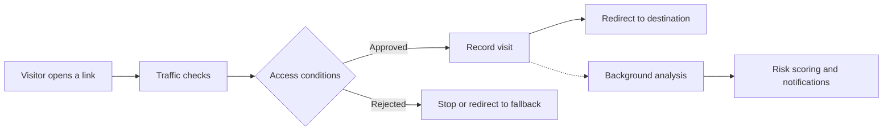
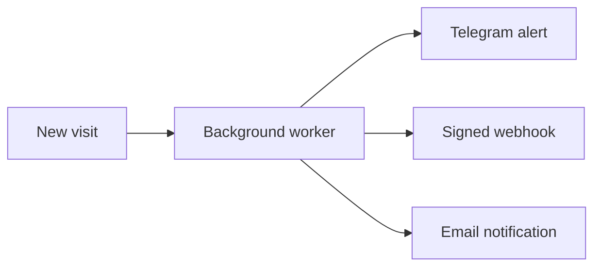

# LinkShield

[](https://www.python.org/)
[](https://supabase.com/)
[](https://ai.google.dev/)
[](https://www.docker.com/)
[](LICENSE)

**Self-hosted link intelligence, traffic analytics, and access protection.**

LinkShield transforms ordinary URLs into an intelligent traffic management layer. It combines link shortening, visitor analytics, conditional routing, bot and VPN detection, lead tracking, notifications, and optional AI-powered analysis in one self-hosted application.

Built for marketers, website owners, agencies, and teams that need greater visibility and control over their incoming traffic.

## What LinkShield Does

- **Traffic Intelligence:** Analyze visitors, identify suspicious traffic, and distinguish potentially automated activity from normal visits.
- **Smart Routing:** Apply password, CAPTCHA, email, consent, country, schedule, and device-based access conditions.
- **Campaign Analytics:** Connect links, visits, visitor signals, and lead activity in a centralized dashboard.
- **Access Protection:** Control how visitors reach protected destinations.
- **Data Ownership:** Host your own application and maintain control over your campaign information.
- **Integrations:** Export data and connect external systems through webhooks, email, and Telegram notifications.

## Core Features

- Short-link creation and destination management.
- Visual routing flows with conditions, access gates, splits, and notifications.
- Browser and device fingerprint collection.
- Bot, scanner, VPN, proxy, and hosting-provider checks.
- Workspaces, invitations, roles, and authentication security features.
- Visitor and lead timelines.
- Campaign-level analytics and dashboards.
- Optional Gemini-powered AI Analyst.
- CSV, JSON, and PDF exports.
- Telegram alerts, SMTP email, and signed webhooks.
- Flask backend, SQLAlchemy, Alembic migrations, and Docker support.
- Optional Supabase integration.

## Architecture

The redirect process is designed to remain lightweight. Additional analysis, notifications, and external integrations can run in the background.

- Flask server-rendered application.
- SQLAlchemy database models.
- Alembic database migrations.
- Background processing for enrichment and notifications.
- Local authentication with optional Supabase integration.
- Docker deployment support.
- Optional AI analysis independent of the core tracking system.

## How It Works



The routing system can stop rejected traffic or send it to a fallback destination. These mechanisms provide an additional layer of control, but do not guarantee detection of every automated visitor or crawler.

## Destination Protection

| LinkShield protected flow | Typical URL inspection tool |
| --- | --- |
|  |  |

Actual behavior depends on the visitor's browser, configuration, and the detection methods available.

## Screenshots

### Campaign Command Center

Monitor campaign activity, traffic quality, risk indicators, and active links.


### Routing Flow Builder

Create visual routing workflows with conditions, access gates, fallback destinations, and notifications.


## Installation

### Requirements

- Python 3
- pip
- Python virtual environment support

### Linux Installation

```bash
git clone https://github.com/farid4545916/LinkShield.git
cd LinkShield
./install.sh --run
```

Open:

http://127.0.0.1:8000

Create the first owner account at `/register`.

### Docker Installation

```bash
git clone https://github.com/farid4545916/LinkShield.git
cd LinkShield
./install.sh --docker --run
```

Alternatively:

```bash
./install.sh --docker
docker compose up --build
```

### Manual Installation

```bash
python3 -m venv venv
source venv/bin/activate
pip install -r server/requirements.txt
cp .env.example .env
SKIP_BACKGROUND_WORKER=1 python -m flask --app server:create_app db upgrade
./run.sh
```

Configure the environment variables in `.env` according to `.env.example`.

## First-Run Checklist

1. Open `/register`.
2. Create the initial owner account.
3. Set up your workspace.
4. Create your first tracking link.
5. Configure the required access conditions.
6. Verify the public server URL.
7. Review security, privacy, and data-retention settings.
8. Configure optional integrations.

## Integrations

### Supabase

Optional Supabase integration for managed authentication.

### AI Analyst

The optional AI Analyst uses campaign information to support natural-language exploration and analysis.

Gemini support is included. AI functionality is optional and is not required for the core application.

### Notifications and Webhooks



Available integrations include:

- Telegram notifications.
- SMTP email.
- Signed webhooks for external applications and automation platforms.

## Project Status

LinkShield is under active development.

The application includes link management, routing, visitor analytics, authentication, workspace management, exports, and integrations. Some advanced traffic correlation and AI-assisted capabilities should be considered experimental until further testing and validation.

Features, configuration, and database structures may change as development progresses.

## Troubleshooting

### Database migration issues

```bash
python -m flask --app server:create_app db upgrade
```

### Docker startup issues

```bash
docker compose ps
docker compose logs --tail=200
```

### Telegram notifications not arriving

Check the bot token, chat ID, and bot permissions.

## Responsible Use and Privacy

LinkShield is intended for legitimate traffic analytics, access management, and campaign monitoring.

Operators are responsible for complying with applicable privacy laws, obtaining consent where required, minimizing retained personal data, and securing their deployments.

LinkShield does not guarantee detection of every bot, proxy, VPN, or automated visitor.

## License

This project is distributed under the terms of the [MIT License](LICENSE).

The original upstream project attribution and license terms remain applicable.
